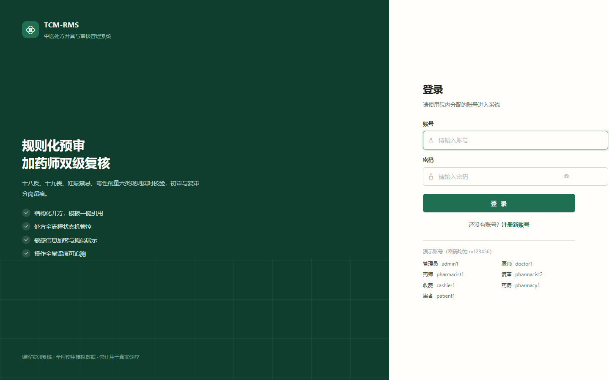
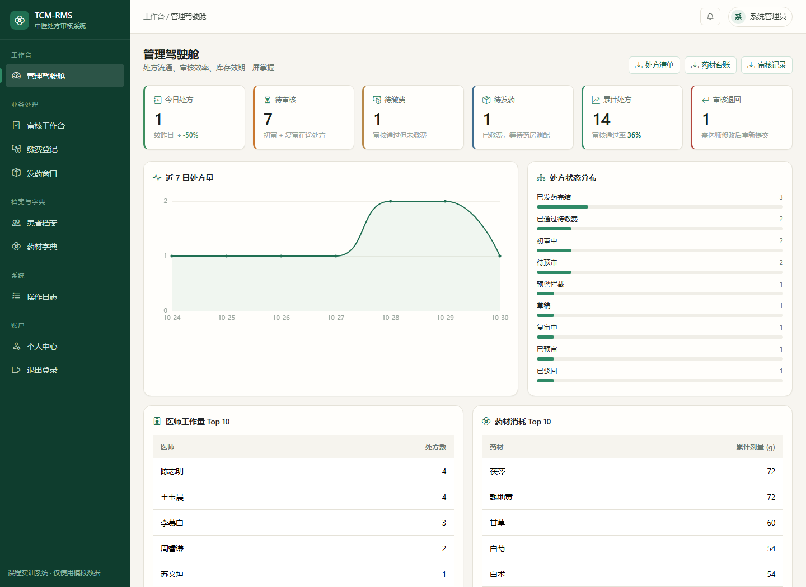
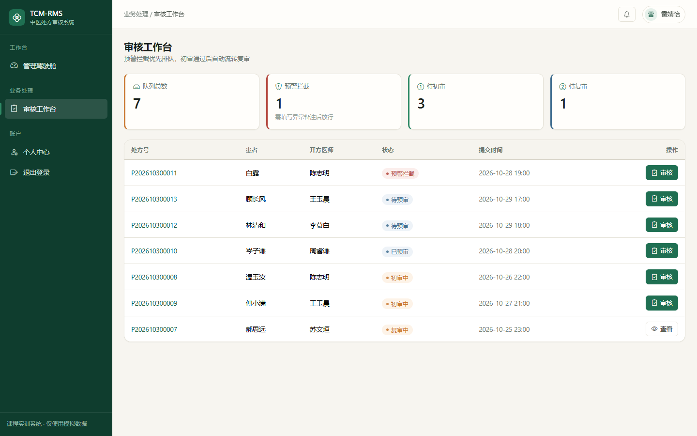
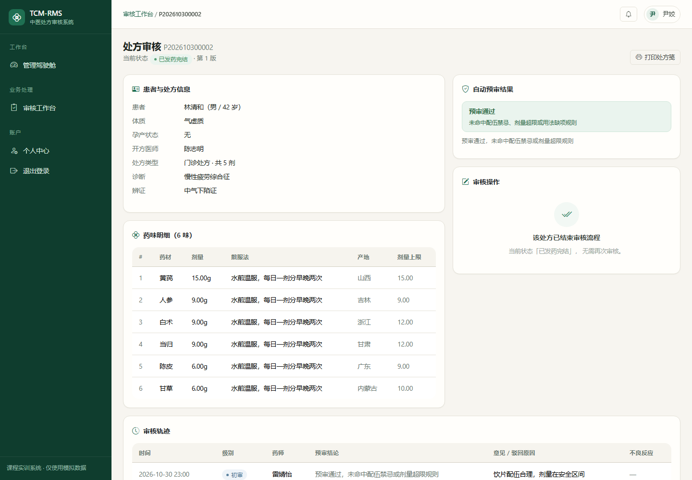
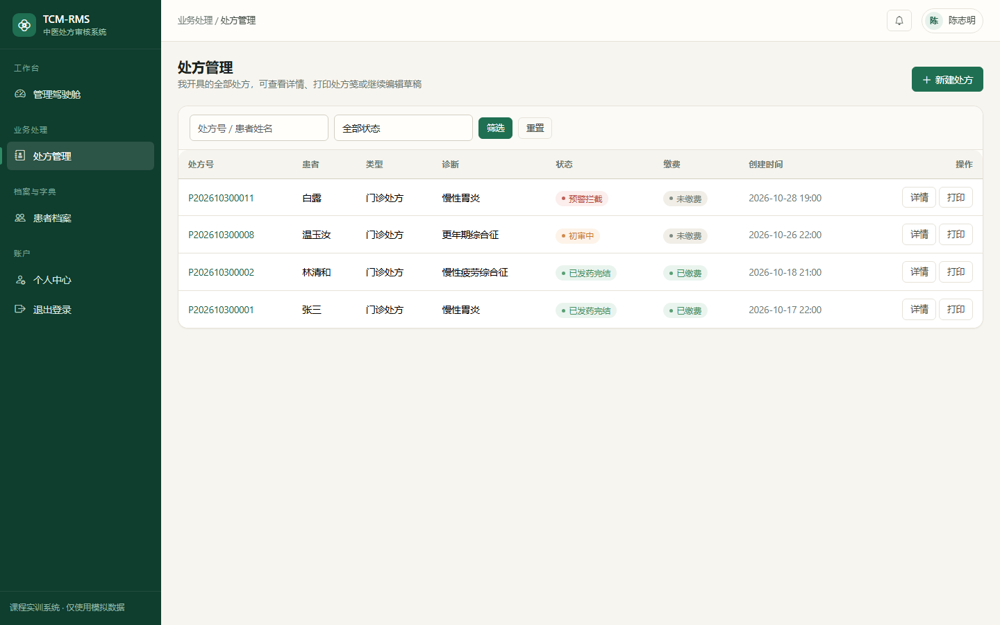
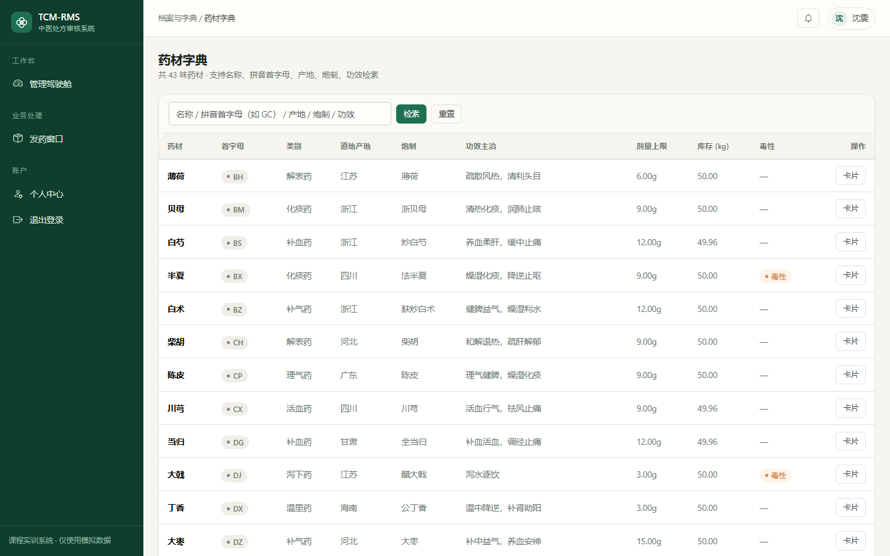

# 中医处方开具与审核管理系统（TCM-RMS）

[](https://github.com/zhaozengmu/zhongyiya-prescription-system/actions/workflows/ci.yml)

基于 **Python 3.12 + Django 5.x** 的中医处方开具与审核管理系统，实现「患者信息管理 — 处方开具管理 — 处方审核管理 — 历史查询与统计」四大核心业务的数字化闭环，并构建 **"规则化自动预审 + 药师人工复核"** 的双层处方审核机制。

> **⚠️ 重要声明**：本项目为《软件工程》课程实训平台，全程使用**模拟虚构数据**，不对接真实业务系统，不采集真实患者隐私信息，**禁止投入真实诊疗环境使用**。

---

## 📷 界面预览

| 登录 | 管理驾驶舱 |
|------|-----------|
|  |  |

| 审核工作台 | 处方审核详情 |
|-----------|-------------|
|  |  |

| 处方管理 | 药材字典 |
|---------|---------|
|  |  |

更多截图见 [`docs/screenshots`](docs/screenshots)。

---

## ✨ 核心特性

- **结构化开方**：方剂模板一键引用、药材字典检索、剂量自动校验，开具耗时由 15~20 分钟压缩至 3~5 分钟。
- **规则化预审**：审核规则引擎覆盖十八反、十九畏、妊娠禁忌、毒性药材剂量上限、用法用量规范、特殊人群六类场景，规则以数据形式存储、在线可维护、版本化管理。
- **状态机管控**：处方在「草稿 → 待预审 → 已预审/预警拦截 → 复核中 → 已通过/已驳回 → 已发药完结」间有序流转，非法迁移在接口层直接拒绝。
- **RBAC 三级权限**：菜单、操作、接口三级权限控制，角色与法定资质绑定（开方仅医师、审核仅药师、发药仅药房）。
- **敏感数据保护**：身份证号、联系电话加密存储、哈希列等值查询、列表掩码展示、详情按权限解密。
- **全程留痕**：操作日志、审核记录全量留痕，支持按人、按时间、按对象追溯。
- **管理驾驶舱**：处方量趋势、医师工作量排名、药材消耗 Top N、驳回原因统计、库存/效期预警等指标可视化（ECharts）。

## ✨ 进阶特性（对标三甲中医院处方审核标准）

- **初审/复审两级审核**：药师初审 → 药师组长复审 → 归档，审核记录含审核人、审核时间、审核意见、驳回原因、不良反应备注。
- **药房发药子模块**：药房人员核对饮片、确认发药、登记发药人，形成「开方→审核→缴费→发药」完整业务闭环。
- **药材全生命周期管理**：道地产地、炮制规格、功效主治、供应商、入库批次、有效期、库存与预警线，支持近效期与库存短缺预警。
- **消息提醒**：处方提交自动提醒药师、审核退回/通过提醒医师、发药完成通知医师。
- **处方类型**：门诊/住院/代煎三类，代煎处方支持代煎备注、取药时间、取药人。
- **患者体质辨识**：九种体质（平和/气虚/阳虚/阴虚/湿热等）+ 过敏史 + 既往病史，开方审核自动带出提醒。
- **拼音首字母检索**：药材检索支持拼音首字母（如输入 GC 搜甘草），经典方剂字典（桂枝汤、麻黄汤、六味地黄丸、逍遥散等）。
- **用户注册**：登录页支持注册新账号（默认患者角色，医师/药师由管理员分配）。

## ✨ 打印导出与备份（本轮新增）

- **处方单 A4 打印/PDF**：标准中药处方笺格式，含处方编号、患者/医师信息、药味明细、剂量煎法、医师/药师/发药三处签章位置，浏览器一键打印或导出 PDF。
- **药材信息卡片打印/PDF**：药材卡片含道地产地、炮制规格、功效主治、库存、入库批次记录，支持打印存档与 PDF 导出。
- **药材字典 Excel 批量导入**：按模板一键导入药材（产地/炮制/功效/库存等 14 列），自动补全拼音首字母。
- **全模块 Excel 导出**：处方清单、药材台账、审核记录、操作日志四类数据一键导出 Excel。
- **一键数据备份**：`python manage.py backup` 备份数据库（SQLite 直接复制文件，MySQL 用 mysqldump），防止处方与药材数据丢失。
- **界面美化**：统一品牌绿色风格，驾驶舱彩色指标卡、预警醒目提示、导航栏药材字典入口。

---

## 🧩 五大功能模块

| 模块 | 负责人 | 三项子功能 |
|------|--------|-----------|
| 用户与医师管理 | 陈志明 | 注册登录退出、医师资料与角色维护、菜单与接口权限配置 |
| 患者信息管理 | 王玉晨 | 患者建档（含过敏史/体质/既往病史）、编辑/删除/详情、分页与条件筛选 |
| 处方开具管理 | 沈雯 | 处方创建（门诊/住院/代煎）、药味明细维护、拼音首字母检索 |
| 处方审核管理 | 尹姣 | 初审/复审两级审核、审核状态流转、异常备注与不良反应留痕 |
| 历史查询与统计 | 雷婧怡 | 多条件组合检索、统计汇总与图表（含驳回原因/库存预警）、日志与结果导出 |

---

## 🏗️ 技术架构

```
表现层      Bootstrap 5 + ECharts（响应式工作台与看板）
应用层      Django App × 5（MTV 分层，视图/表单/业务逻辑编排）
支撑服务层  审核规则引擎、RBAC、日志审计、报表导出（Pandas/OpenPyXL）
数据层      MySQL 8.0 + Redis（结构化存储 + 字典缓存）
运行环境    Nginx + Gunicorn + systemd（单机部署，可平滑扩展）
```

数据存储划分（D1~D6）：

| 编号 | 数据存储 | 主要数据表 |
|------|---------|-----------|
| D1 | 用户与权限库 | user、role、permission、role_permission |
| D2 | 患者档案库 | patient |
| D3 | 中药与方剂字典 | herb、formula_template、formula_item、audit_rule |
| D4 | 处方与明细库 | prescription、prescription_item |
| D5 | 审核记录库 | review_record |
| D6 | 日志与统计库 | operation_log、stat_daily |

---

## 🚀 快速开始

### 1. 环境要求

- Python 3.12+
- （可选）MySQL 8.0 / Redis —— 开发环境默认使用 SQLite + 本地内存缓存，无需额外配置

### 2. 安装依赖

```bash
# 创建虚拟环境
python -m venv .venv

# Windows
.venv\Scripts\activate
# macOS / Linux
source .venv/bin/activate

# 安装依赖
pip install -r requirements.txt
```

### 3. 配置环境变量

```bash
# 开发环境可以跳过，系统会用不安全的默认值并打印告警
cp .env.example .env
```

`.env` 里只有两项在生产环境**必须**显式设置，否则系统会拒绝启动（fail-closed，避免带着明文密钥或调试页上线）：

| 变量 | 说明 | 缺失后果 |
|------|------|---------|
| `DJANGO_SECRET_KEY` | 50 位以上随机串 | 生产环境启动失败 |
| `DATA_ENCRYPTION_KEY` | Fernet 密钥，用于患者身份证/手机号加密 | 生产环境启动失败 |

```bash
# 生成密钥
python -c "import secrets; print(secrets.token_urlsafe(64))"
python -c "from cryptography.fernet import Fernet; print(Fernet.generate_key().decode())"
```

### 4. 初始化数据库

```bash
python manage.py migrate
python manage.py init_data            # 角色、权限、规则库、药材字典、方剂、演示账号与患者档案
python manage.py seed_prescriptions   # 生成 14 张覆盖各状态的演示处方（可选，让看板有数据）
```

### 5. 启动服务

```bash
python manage.py runserver
```

访问 http://127.0.0.1:8000/ 即可进入系统。

### 6. 演示账号

| 角色 | 用户名 | 密码 |
|------|--------|------|
| 系统管理员 | `admin1` | `rx123456` |
| 医师（内科/妇科/针灸/儿科） | `doctor1` ~ `doctor5` | `rx123456` |
| 药师（初审） | `pharmacist1` | `rx123456` |
| 药师组长（复审） | `pharmacist2` | `rx123456` |
| 收费员 | `cashier1` | `rx123456` |
| 药房管理员 | `pharmacy1` | `rx123456` |
| 患者 | `patient1` | `rx123456` |

> 账号被改密码或锁定后，用 `python manage.py init_data --reset-demo` 一键恢复。
> 演示患者档案共 10 份（张三、林清和、苏念慈、顾长风、白露、郝思远、温玉汝、邵明轩、傅小满、岑子谦），
> 覆盖孕期、儿童、老年、痰湿/湿热/血瘀等不同体质，便于验证审核规则的差异化提示。

> 没有账号？直接在登录页点击「注册新账号」，注册默认为患者角色；
> 医师、药师、药房、医务科等角色须由系统管理员分配（符合角色与法定资质绑定的设计）。

---

## 📡 主要接口清单

所有业务接口统一以 `/api/v1/` 为前缀，返回统一 JSON 结构 `{code, message, data, timestamp}`。

| 方法 | 路径 | 说明 | 所需权限 |
|------|------|------|---------|
| POST | `/api/v1/auth/login` | 登录 | 公开 |
| GET | `/api/v1/patients` | 患者分页检索 | 患者:读 |
| POST | `/api/v1/patients/create` | 患者建档 | 患者:新增 |
| GET | `/api/v1/doctors` | 医师列表 | 用户:读 |
| POST | `/api/v1/prescriptions` | 新建处方（草稿） | 处方:新增 |
| PUT | `/api/v1/prescriptions/{id}` | 修改草稿明细 | 处方:修改 |
| POST | `/api/v1/prescriptions/{id}/submit` | 提交待预审 | 处方:提交 |
| POST | `/api/v1/prescriptions/{id}/pay` | 收费确认（APPROVED → 已缴费） | 收费:确认 |
| GET | `/api/v1/reviews/tasks` | 待审队列 | 审核:读 |
| POST | `/api/v1/reviews/{id}/claim` | 领取任务 | 审核:领取 |
| POST | `/api/v1/reviews/{id}/approve` | 复核通过/放行 | 审核:通过 |
| POST | `/api/v1/reviews/{id}/reject` | 退回 | 审核:退回 |
| GET | `/api/v1/reviews/{id}/history` | 审核轨迹 | 审核:读 |
| POST | `/api/v1/reviews/{id}/dispense` | 发药确认（扣减库存） | 发药:确认 |
| GET | `/api/v1/stats/overview` | 驾驶舱指标 | 统计:读 |
| GET | `/api/v1/logs` | 操作日志 | 日志:读 |
| GET | `/api/v1/export/prescriptions` | 导出 Excel | 导出:执行 |

---

## 📋 处方审核规则库（初始清单）

规则均取自《中华人民共和国药典》（2020 年版一部）及中医药配伍禁忌通行规范，共六类：

| 规则类型 | 示例 | 处理方式 |
|---------|------|---------|
| 十八反 | 甘草反甘遂/大戟/海藻/芫花；乌头反半夏/瓜蒌/贝母 | 自动拦截，强制药师复核 |
| 十九畏 | 硫黄畏朴硝；人参畏五灵脂；丁香畏郁金 | 预警提示，药师填写理由可放行 |
| 妊娠禁忌 | 孕妇禁用麝香、三棱、莪术 | 结合孕产状态强制拦截或分级警示 |
| 毒性剂量上限 | 附子、细辛、制川乌、制草乌按药典上限校验 | 超限拦截，双签确认 |
| 用法用量规范 | 单剂味数、煎服法标注完整性 | 缺项提醒 |
| 特殊人群 | 儿童、老年患者剂量折算 | 提示参考折算剂量 |

---

## 🗂️ 项目结构

```
tcm-prescription-system/
├── manage.py
├── requirements.txt
├── pyproject.toml           # ruff 静态检查与格式化配置
├── Dockerfile               # python:3.12-slim + Gunicorn
├── .env.example             # 环境变量模板
├── config/                  # 项目配置（settings/urls/wsgi/asgi）
├── apps/
│   ├── users/               # 用户与医师管理（D1）
│   │   ├── context_processors.py  # 权限驱动的侧边栏导航
│   │   ├── permissions.py         # 权限校验 / 403 拒绝 / 客户端 IP
│   │   └── services.py           # 登录锁定、角色落地页
│   ├── patients/            # 患者信息管理（D2）
│   ├── prescriptions/       # 处方开具管理（D3、D4）
│   │   ├── selectors.py     # 数据可见范围收口（防 IDOR）
│   │   └── management/commands/seed_prescriptions.py  # 演示处方流水
│   ├── reviews/             # 处方审核管理（D4、D5）
│   │   ├── engine.py        # 审核规则引擎
│   │   ├── state_machine.py # 处方状态机（CAS 条件更新）
│   │   ├── services.py      # 领取/通过/退回/收费/发药事务
│   │   └── tests_business.py # 权限隔离与缴费→发药闭环测试
│   ├── stats/               # 历史查询与统计（D4、D5、D6）
│   └── utils/               # 加密、哈希、模板过滤器（tcm_tags）
├── templates/               # 全局模板（含统一 no_permission.html）
├── static/
│   ├── css/app.css          # 设计系统（CSS 变量令牌）
│   ├── css/auth.css         # 登录/注册分栏版式
│   └── js/app.js            # Toast、防重复提交、tcmApi 封装
├── docs/screenshots/        # 界面截图
└── .github/workflows/ci.yml # CI：ruff + check + 迁移 + 测试
```

---

## 🔐 安全设计要点

- **身份认证**：密码 PBKDF2 加盐哈希；连续 5 次失败锁定 10 分钟（`LOGIN_MAX_ATTEMPTS` / `LOGIN_LOCK_SECONDS` 可调），失败计数与锁定时间**持久化到数据库**，重启服务不会清零。
- **配置兜底（fail-closed）**：`DEBUG` 默认 `False`；生产环境缺少 `DJANGO_SECRET_KEY` 或 `DATA_ENCRYPTION_KEY` 时**启动即失败**，绝不静默降级为明文或调试模式。
- **数据保密**：身份证号、联系电话用 Fernet 对称加密落库，另存 HMAC-SHA256 哈希列用于等值查询（不可逆），列表页掩码展示，详情页按权限解密。HMAC 使用独立密钥，与加密密钥分离。
- **越权防护**：
  - 页面级越权返回 **403**（含统一无权限页与审计日志），而非"渲染空页 + 200"。
  - 数据级越权在 `selectors` 层收口：查不到即 404，不泄露"该记录存在但你不能看"。
  - 接口级越权由 `@permission_required` 拦截，防止"按钮隐藏但接口可直接调用"。
  - 患者自助查询按 `patient.user` 隔离，只能看到本人处方。
- **写操作防护**：所有变更类接口强制 `POST`（`@require_POST`），杜绝 GET 触发状态变更被爬虫或预取误触。
- **并发安全**：状态机迁移使用条件更新（`filter(pk=..., status=当前状态).update(...)`）实现 CAS，两人同时审核同一处方时只有一次成功；处方号生成带唯一约束重试。
- **输入防护**：全站 CSRF 校验、ORM 参数化防 SQL 注入、模板转义防 XSS、文件上传类型/大小限制。
- **审计留痕**：操作日志覆盖登录、处方增删改、审核结论、越权访问、数据导出，留存不少于 6 个月。

---

## 🎨 界面设计系统

统一设计语言，告别"Bootstrap 默认样式 + emoji 凑图标"：

| 设计要素 | 取值 | 说明 |
|---------|------|------|
| 主色（艾草绿） | `#1f6f52` | 主按钮、选中态、品牌标识 |
| 辅色（药柜木） | `#b8894a` | 分隔、印章、次级强调 |
| 底色（宣纸） | `#f7f5f0` | 页面背景，降低长时间注视疲劳 |
| 图标 | Bootstrap Icons（CDN） | 全站移除 emoji 图标 |
| 字体 | 系统字体栈 + 中文优先 | 不依赖外网字体，内网可用 |

- **设计令牌集中管理**：所有颜色/间距/圆角定义在 `static/css/app.css` 的 CSS 变量中，改一处全站生效。
- **权限驱动导航**：侧边栏由 `apps/users/context_processors.py` 按当前用户权限动态生成，无权限的菜单项不渲染，前后端权限来源唯一。
- **登录/注册独立版式**：`static/css/auth.css` 提供左侧品牌面板（药柜格纹底） + 右侧表单的分栏布局。
- **交互细节**：Toast 自动消失、提交按钮防重复点击、移动端侧栏折叠、CSRF Token 通过 `<meta>` 暴露给 `static/js/app.js`（因 `CSRF_COOKIE_HTTPONLY=True`，前端无法读 Cookie）。

---

## 🛠️ 工程化

```bash
# 静态检查（配置见 pyproject.toml）
ruff check .
ruff format --check .

# 系统检查 + 迁移一致性 + 单元测试
python manage.py check
python manage.py makemigrations --check --dry-run
python manage.py test apps
```

- **CI**：`.github/workflows/ci.yml` 在 push / PR 时执行 ruff 静态检查、`manage.py check`、迁移遗漏检查、单元测试四道关卡。
- **容器化**：`Dockerfile` 基于 `python:3.12-slim`，内置 pango/cairo 以支持 PDF 导出，用 Gunicorn 3 worker 启动。
- **依赖分层**：`requirements.txt` 区分「运行时必需 / 生产部署 / 可选」三档，未装 WeasyPrint 时 PDF 自动降级为浏览器打印，不会因缺少可选依赖而崩溃。

---

## 📚 参考文档

- 《中华人民共和国中医药法》
- 《处方管理办法》（卫生部令第 53 号）
- 《中华人民共和国个人信息保护法》
- 《中华人民共和国药典》（2020 年版一部）
- GB/T 22239—2019《信息安全技术 网络安全等级保护基本要求》
